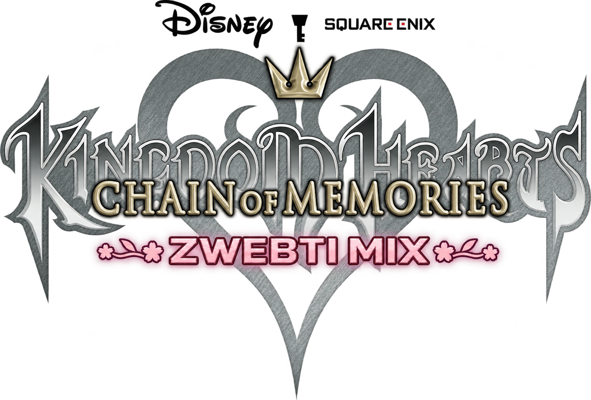

# Kingdom Hearts Chain of Memories: Zwebti Mix

Windows action playtest **0.11.1**, based on ReKHCoM. Requires your own supported unmodified USA cartridge dump. Open **Kingdom Hearts Chain of Memories - Zwebti Mix 0.11.1.exe** and choose Story or Practice Arena. This update connects the native combat tree through shorter recovery links, deliberate opening variations and bounded defensive continuation.

## Controller combat tree

Three normal South-button attacks always come before the fourth-input finisher. Direction and tap/hold choose the branch; no finisher menu or favorite hotkeys are used. Native animations, multi-hit phases, sound, screen darkening, projectiles and recovery remain part of the attack. Casting between sword hits preserves your place in the physical string without replacing any of its three normals. Neutral keeps the familiar opening swing. On the first attack, stick up/down selects the native wide cut; LT + stick up selects the rising hop. These are opening variations inside the same three-normal sequence, not shortcuts to a finisher. Compatible recovery links retain each actual strike and protect the finisher's complete native sequence.

| Control | Action |
|---|---|
| Left stick | Movement; horizontal branches are relative to Sora's facing |
| South (A / Cross) | Attack; fourth press chooses contextual finisher |
| East (B / Circle) | Jump |
| West (X / Square) | Dodge |
| North (Y / Triangle), held | Frontal guard |
| LB / RB | Previous / next magic element |
| RT | Cast selected magic; hold for higher native tiers |
| LT | Elemental finisher / advanced-magic modifier |
| Right-stick click | Call selected assist after the gold gauge is full; hold for more of its native sequence |
| D-pad left / right | Select one of 14 assist characters |
| D-pad up / down | Select one of 17 obtained native Keyblades |

| Fourth South input | Tap | Hold at least about 0.2 seconds |
|---|---|---|
| Neutral | Blitz | Ars Arcanum |
| Toward | Sliding Dash | Sonic Blade |
| Away | Strike Raid | Zantetsuken |
| Stick up | Ragnarok | Ragnarok |
| Stick down | Stun Impact | Stun Impact |
| Airborne | Air Rush / Sonic Blade | Air Rush / Sonic Blade |

Hold LT with the fourth South input to use the selected element's raid: Fire Raid, Blizzard Raid, Thunder Raid, Judgment (Cure), Gravity Raid, Stop Raid, Reflect Raid (Aero). Charged LT branches are Firaga Break with Fire, Shock Impact with Thunder, or Trinity Limit with Cure. The others retain the matching raid. A recently buffered ground-only branch waits for a safe landing; old requests expire rather than firing after a long unrelated wait.

A short RT press uses the base spell. About0.2 seconds charges its next tier; about0.5 seconds reaches the strongest tier. LT + RT opens advanced native spells:

| Element | Neutral / toward | Away | Stick up | Stick down |
|---|---|---|---|---|
| Fire | Homing Fira | Homing Fira | Mega Flare | Mega Flare |
| Blizzard | Homing Blizzara | Homing Blizzara | Aqua Splash | Aqua Splash |
| Thunder | Thundaga | Thundaga | Thundaga | Thundaga |
| Cure | Gifted Miracle | Gifted Miracle | Holy | Holy |
| Gravity | Synchro | Warpinator | Quake | Warp |
| Stop | Bind | Confuse | Terror | Teleport |
| Aero | Tornado | Tornado | Tornado | Tornado |

Native conditional moves retain their roles. Shock Impact launches/stops rather than inventing HP damage; Aqua Splash is an elevated steerable stream. Magic spends MP; melee contacts restore it. Normal attacks allow immediate defense cancels. Guard or roll after a performed normal preserves a brief chance to continue the chain; canceling before its strike or taking damage resets that progress. Repeated defense does not extend the opportunity indefinitely. Committed finishers allow their supported late defense windows. Offensive mashing never restarts a playing action, and an old tap made early in a long finisher expires.

## Independent assists

The single gold gauge builds from Sora's real attacks and precise dodges. Once full, press right-stick click to call the selected character. Sora stays visible and can attack, move, jump, guard and roll. The full authored companion task plays independently, with its own sprite storage; no Sora summon takeover, disappearance or fake one-hit replacement is used. Damage remains real, and Tinker Bell heals incrementally without erasing incoming hits.

Selection shows one family name: Simba, Genie, Bambi, Dumbo, Tinker Bell, Mushu, Cloud, Donald, Goofy, Aladdin, Ariel, Jack, Peter Pan, Beast. Tap/hold provides native power/sequence variations; the list has no repeated levelI/II/III entries. LT + right-stick click calls Idyll Romp for Bambi, Cross-slash+ for Cloud, or Blazing Donald. Other families keep their ordinary charge branches. World allies work outside their original worlds in Sora action combat.

Only one assist owns its graphics at a time. A second completed request waits without spending the gauge. Gauge is deducted only after a successful spawn. Shared native background effects take safe turns, while Sora's ordinary combat continues; a native assist pauses during a conflicting player cinematic and resumes its remaining sequence. Compatible physical companions can overlap safe startup/recovery phases; phases that share hit locks still take turns so overlap cannot duplicate Sora's damage. Trinity Limit waits for an existing assist to leave before its original team sequence begins. Earned gauge, assist family, magic and Keyblade selection carry between battles in the current session; queues and unfinished charges do not.

## HUD and native inventory

Sora's original normal, hurt and low-HP portraits are at bottom right, beside one green total-HP bar, one blue MP bar, a tiny magic mark and a narrow gold assist gauge with the selected character name. No persistent command deck or combat control legend is shown.

There are **116 meaningful native gameplay routes**:36 magic entries,18 finishers/team techniques,45 assist variants and17 obtained Keyblades. Seven original card-reload items and the unused duplicate Keyblade remain documented in the124-entry dispatcher inventory; they are not presented as new card-free attacks.

The expanded searchable metadata catalog also inventories the entire checkout's authored sprite sheets, frames, timelines, palettes, animation bindings, task/effect APIs, all330 battle attack definitions, attack-box calls and actor states. It contains source references and coverage results, not ROM bytes. See `development/NATIVE_CATALOG.md` and `port/tools/build_native_catalog.py`. No external custom sprites were imported. Bounded native sparkle/flash accents follow real contacts, with compact light impacts and stronger heavy impacts. Contacts at the same location in one tick share an accent; later multi-hit beats remain distinct. Native screen darkening, hit pauses and multi-hit effects remain intact.

## Profiles and scope

Story and Practice profiles remain separate under `%LOCALAPPDATA%/Kingdom Hearts Chain of Memories - Zwebti Mix/profile`. Updates install immutable version folders and retain previous versions. Restart the game and launcher after updating.

Full campaign balance and physical controller testing remain unverified. See `launcher/VALIDATION.md` for the exact tested build and checks. Riku/classic/link combat keeps its native rules. The [full-name GitHub repository](https://github.com/ramizwebti/kingdom-hearts-chain-of-memories-zwebti-mix) is maintained through Composure. [Combat research](development/COMBAT_RESEARCH.md) records the source audit and design principles behind this update. The launcher checks only this project's releases; prior versions and profiles remain separate.
